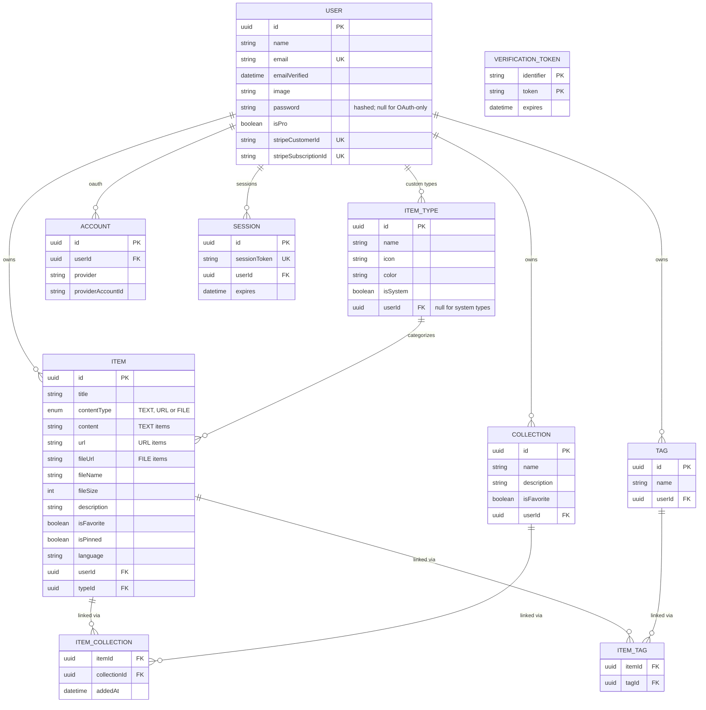
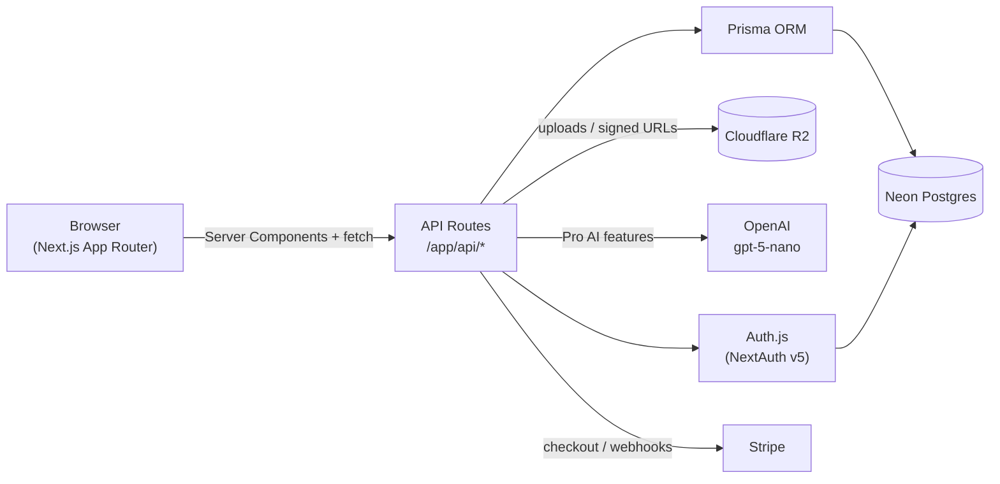

# DevStash — Project Overview

> One fast, searchable, AI-enhanced hub for all your dev knowledge & resources.

**Status:** Planning / pre-MVP · **Last updated:** 2026-09-24

## Table of Contents

1. [Problem & Vision](#1-problem--vision)
2. [Target Users](#2-target-users)
3. [Features](#3-features)
4. [Data Model](#4-data-model)
5. [Tech Stack](#5-tech-stack)
6. [System Architecture](#6-system-architecture)
7. [Monetization](#7-monetization)
8. [UI / UX](#8-ui--ux)
9. [Open Questions](#9-open-questions--not-yet-decided)
10. [Engineering Guardrails](#10-engineering-guardrails)

---

## 1. Problem & Vision

Developers keep their essentials scattered across too many tools:

- Code snippets in VS Code or Notion
- AI prompts buried in old chats
- Context files scattered across projects
- Useful links in browser bookmarks
- Docs in random folders
- Shell commands in `.txt` files or bash history
- Project templates in GitHub Gists

This creates constant context-switching, lost knowledge, and inconsistent workflows.

**DevStash** is a single, fast, searchable, AI-enhanced hub for all dev knowledge and resources — snippets, prompts, notes, commands, files, images, and links — organized into collections and accessible from a quick-entry drawer.

## 2. Target Users

| Persona | Core need |
|---|---|
| 🧑‍💻 **Everyday Developer** | A fast way to grab snippets, prompts, commands, and links without leaving flow |
| 🤖 **AI-first Developer** | A place to save prompts, contexts, system messages, and reusable workflows |
| 🎓 **Content Creator / Educator** | Storage for code blocks, explanations, and course notes |
| 🏗️ **Full-Stack Builder** | A library of patterns, boilerplates, and API examples |

## 3. Features

### 3.1 Items & Item Types

Every piece of saved knowledge is an **Item**. Items belong to a **type**, and types are either plain text, a URL, or a file. Users can eventually define custom types, but DevStash ships with a fixed set of **system types** that cannot be renamed or deleted:

| Type | Kind | Icon (lucide-react) | Color |
|---|---|---|---|
| `snippet` | text | `Code` | `#3b82f6` (blue) |
| `prompt` | text | `Sparkles` | `#8b5cf6` (purple) |
| `command` | text | `Terminal` | `#f97316` (orange) |
| `note` | text | `StickyNote` | `#fde047` (yellow) |
| `link` | url | `Link` | `#10b981` (emerald) |
| `file` *(Pro)* | file | `File` | `#6b7280` (gray) |
| `image` *(Pro)* | file | `Image` | `#ec4899` (pink) |

Route convention for browsing by type: `/items/[type]` (e.g. `/items/snippets`, `/items/prompts`).

Items are designed to be created and edited quickly from a slide-out **drawer**, without a full page navigation.

### 3.2 Collections

**Collections** group items of any type together, e.g.:

- *React Patterns* — snippets, notes
- *Context Files* — files
- *Python Snippets* — snippets
- *Interview Prep* — a mix of snippets and notes

An item can belong to **multiple collections** at once (a React snippet can live in both *React Patterns* and *Interview Prep*). Every item shows which collections it currently belongs to, and can be added to or removed from any of them.

### 3.3 Search

Fast, unified search across:

- Item content
- Tags
- Titles
- Item type

### 3.4 Authentication

- Email / password
- GitHub OAuth

Built on **Auth.js (NextAuth v5)**.

### 3.5 AI Features (Pro only)

- AI auto-tag suggestions
- AI summaries
- "Explain this code"
- Prompt optimizer

### 3.6 Other Features

- Favorite items and collections
- Pin items to the top
- Recently used
- Import code from a file
- Markdown editor for text-based types
- File upload for file / image types
- Export data in multiple formats
- Dark mode (default) / light mode
- Add or remove an item from multiple collections at once
- View which collections an item belongs to, from the item itself

## 4. Data Model

### 4.1 Entity Relationship Diagram

### 4.2 Prisma Schema

**`prisma/schema.prisma` is the source of truth.** It is no longer reproduced here — a second copy only drifts. This section records the decisions behind it that the schema file alone does not explain.

Auth models follow the standard [Auth.js Prisma adapter](https://authjs.dev/getting-started/adapters/prisma) shape, so `@auth/prisma-adapter` drops in as-is.

| Model | Notes |
|---|---|
| `User` | Auth.js fields (`name`, `emailVerified`, `image`) plus billing (`isPro`, Stripe ids) |
| `Account` / `Session` / `VerificationToken` | Auth.js adapter models; untouched from the reference shape |
| `Item` | One row per saved thing; payload field depends on `contentType` |
| `ItemType` | System types have `userId = null`; user-defined types (Pro) are owner-scoped |
| `Collection` | Owner-scoped, unique name per user |
| `ItemCollection` | Join: item ↔ collection many-to-many, carries `addedAt` |
| `Tag` / `ItemTag` | Owner-scoped tags, joined to items |

#### Naming

The database uses **`snake_case`**, plural tables: `users`, `items`, `item_types`, `item_collections`, `verification_tokens`, and columns like `created_at`, `user_id`, `is_favorite`. The `ContentType` enum is the `content_type` type.

Prisma models and fields stay PascalCase/camelCase for the TypeScript client; `@map` / `@@map` bridge the two. This is not cosmetic: Postgres folds unquoted identifiers to lowercase, so a table created as `"ItemType"` can only ever be reached as `"ItemType"` with quotes — in psql, in raw SQL, in every BI or migration tool. snake_case keeps `select * from item_types` working unquoted.

#### Decisions that differ from the original draft

- **`ItemCollection` join table replaces `Item.collectionId`.** [§3.2](#32-collections) requires an item to live in several collections at once, which a single FK cannot express. The join mirrors `MOCK_ITEM_COLLECTIONS` from the dashboard mock data.
- **`contentType` is a Postgres enum** (`TEXT` / `URL` / `FILE`), not a free-text string — it matches the `ContentType` union the dashboard already uses, so invalid values are rejected by the database rather than by convention.
- **`Item.type` uses `onDelete: Restrict`.** Every other relation cascades from its owner, but deleting an item type must not silently delete the user's items.
- **Cascade deletes** run from `User` down through items, collections, types, tags and both join tables, so removing an account leaves nothing orphaned.
- **Indexes** cover every foreign key plus the dashboard's real access paths — `(userId, updatedAt DESC)` for recent lists, and `(userId, isPinned)` / `(userId, isFavorite)` for the pinned and favourite sections.
- **Primary keys are UUIDv7 in native `uuid` columns** (`@default(uuid(7)) @db.Uuid`), not cuids in `text`. v7 is time-ordered, so inserts append to the right edge of the index rather than scattering across it and splitting pages; the native type stores 16 bytes against 36 for a text cuid, which keeps every index and foreign key smaller. Every FK column is `@db.Uuid` too — Postgres rejects a foreign key whose type does not match its target. The tradeoff accepted: a v7 id embeds its creation timestamp, so anyone holding one can infer when the row was made.
- **System `ItemType` ids are fixed UUIDs** from a reserved block (`00000000-0000-7000-8000-00000000000N`), seeded via `prisma/seed.ts`. `@@unique([userId, name])` cannot guard them because Postgres treats NULL `userId`s as distinct, so the seed upserts by id to stay idempotent. They are deliberately recognisable as synthetic.

#### Connections

Two Neon connection strings from the same branch, and they are not interchangeable:

| Var | Pooled? | Used by |
|---|---|---|
| `DATABASE_URL` | yes (`-pooler` host) | the app, via `@prisma/adapter-neon` in `src/lib/prisma.ts` |
| `DIRECT_URL` | no | the Prisma CLI, via `prisma.config.ts` |

Migrations hold advisory locks and need long-lived sessions, which a transaction pooler cannot provide. See `.env.example`.

## 5. Tech Stack

| Layer | Choice | Notes |
|---|---|---|
| Framework | [Next.js 16](https://nextjs.org/docs) / [React 19](https://react.dev) | App Router, SSR pages with dynamic components; API routes for backend needs (items, file uploads, AI calls). Single codebase/repo. |
| Language | TypeScript | End-to-end type safety |
| Database | [Neon](https://neon.tech/docs) (serverless Postgres) | Cloud-hosted Postgres |
| ORM | [Prisma 7](https://www.prisma.io/docs) (pinned `7.10.0`) | Config in `prisma.config.ts`; client generated to `src/generated/prisma`; connects via the `@prisma/adapter-neon` driver adapter. ⚠️ Always via migrations — see [§10](#10-engineering-guardrails) |
| Caching | Redis | Maybe, TBD |
| File storage | [Cloudflare R2](https://developers.cloudflare.com/r2/) | Uploads for `file` / `image` items |
| Auth | [Auth.js / NextAuth v5](https://authjs.dev) | Email/password + GitHub OAuth |
| AI | [OpenAI API](https://platform.openai.com/docs) — `gpt-5-nano` | Pro-only AI features |
| Styling | [Tailwind CSS v4](https://tailwindcss.com/docs) + [shadcn/ui](https://ui.shadcn.com) | Dark mode default |
| Payments | [Stripe](https://stripe.com/docs) | Subscriptions (`isPro`, customer/subscription IDs on `User`) |

## 6. System Architecture

## 7. Monetization

Freemium model.

| | **Free** | **Pro** — $8/mo or $72/yr |
|---|---|---|
| Items | 50 total | Unlimited |
| Collections | 3 | Unlimited |
| System types | All except `file` / `image` | All, incl. `file` / `image` |
| File & image uploads | ❌ | ✅ |
| Custom types | — | Coming later |
| Search | Basic | Basic |
| AI auto-tagging | ❌ | ✅ |
| AI code explanation | ❌ | ✅ |
| AI prompt optimizer | ❌ | ✅ |
| Data export | ❌ | ✅ (JSON / ZIP) |
| Support | — | Priority |

> During development, all users can access everything. Build the `isPro` foundation (schema fields, gating hooks) now, but don't enforce limits until closer to launch.

## 8. UI / UX

**General direction:** modern, minimal, developer-focused. Dark mode by default, light mode optional. Clean typography, generous whitespace, subtle borders/shadows. Reference points: [Notion](https://notion.so), [Linear](https://linear.app), [Raycast](https://raycast.com). Syntax highlighting on all code blocks.

## Screenshots

Refer to the screenshots below as a base for the dashboard ui. It doesn't have to be exact. Use it as a reference.
- @context/screenshots/dashboard-ui-main.png
- @context/screenshots/dashboard-ui-drawer.png
For responsive/mobile version, reference these:
- @context/screenshots/dashboard-ui-main-responsive.png
- @context/screenshots/dashboard-ui-drawer-responsive.png
- @context/screenshots/dashboard-ui-menu-responsive.png

### 8.1 Layout

- **Sidebar** (collapsible): item types with links to their items (snippets, commands, etc.), plus latest collections
- **Main area**: grid of color-coded collection cards, background-tinted by the type that makes up most of their items; items render inside collections as color-coded cards (border color = item type color)
- **Item detail**: opens in a quick-access side drawer, not a full page

### 8.2 Type Colors & Icons

See the table in [§3.1](#31-items--item-types) — reused consistently across sidebar icons, card borders/backgrounds, and badges.

### 8.3 Responsive & Micro-interactions

- Desktop-first, but fully usable on mobile — sidebar collapses into a drawer
- Smooth transitions and hover states on cards
- Toast notifications for actions (save, delete, add to collection, etc.)
- Loading skeletons while data fetches

## 9. Open Questions / Not Yet Decided

- Redis for caching — needed, or is Neon fast enough at MVP scale?
- Custom item types — data model supports them (`ItemType.userId`), but the UI/flow ships later
- Export formats — confirm exact set (JSON confirmed; ZIP for files — what else?)
- Rate limits / quota enforcement mechanics for the Free tier (hard block vs. soft warning)
- Exact shape of the AI prompt optimizer (input/output contract)

## 10. Engineering Guardrails

- **Never** use `prisma db push` or hand-edit the database schema directly. All schema changes go through **Prisma Migrate**, run in dev first, then promoted to prod.
- `prisma/schema.prisma` is the source of truth for the data model. Expect it to shift as features are implemented; when it does, update [§4](#4-data-model) — the ERD and the decision notes, which are the parts this doc still owns.
- The Prisma CLI must use `DIRECT_URL` (unpooled) and the app must use `DATABASE_URL` (pooled). Migrations take advisory locks and cannot run through Neon's pooler.
- Database identifiers are `snake_case` (plural tables). New models and fields need `@map` / `@@map` — see [§4.2](#42-prisma-schema).
- `prisma migrate dev` does **not** regenerate the client in Prisma 7. Run `npm run db:generate` after a schema change, or you will hit `TableDoesNotExist` against a stale client.
- Pin `prisma` and `@prisma/client` to the same **GA** version and upgrade them together. npm's `latest` tag on `prisma` has pointed at a release candidate — check `npm view prisma dist-tags` rather than trusting `@latest`.
