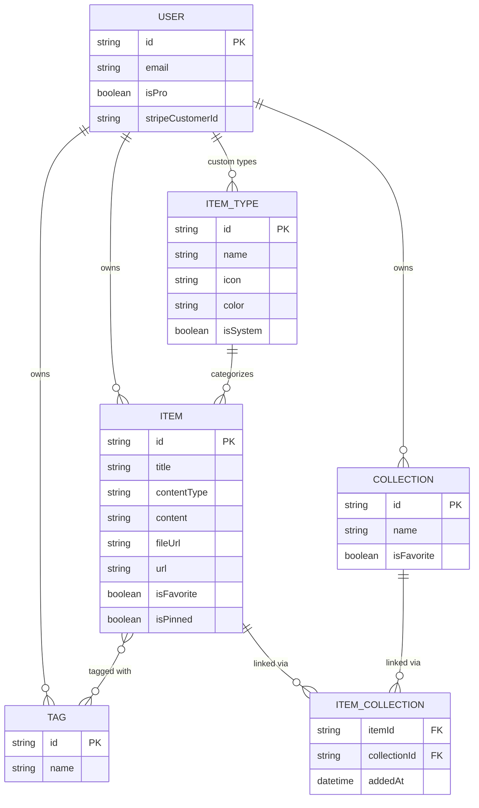
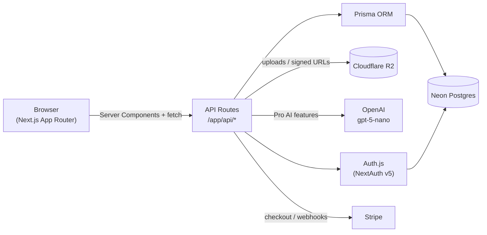

# DevStash — Project Overview

> One fast, searchable, AI-enhanced hub for all your dev knowledge & resources.

**Status:** Planning / pre-MVP · **Last updated:** 2026-09-21

## Table of Contents

1. [Problem & Vision](#1-problem--vision)
2. [Target Users](#2-target-users)
3. [Features](#3-features)
4. [Data Model](#4-data-model)
5. [Tech Stack](#5-tech-stack)
6. [System Architecture](#6-system-architecture)
7. [Monetization](#7-monetization)
8. [UI / UX](#8-ui--ux)
9. [Open Questions](#9-open-questions--not-yet-decided)
10. [Engineering Guardrails](#10-engineering-guardrails)

---

## 1. Problem & Vision

Developers keep their essentials scattered across too many tools:

- Code snippets in VS Code or Notion
- AI prompts buried in old chats
- Context files scattered across projects
- Useful links in browser bookmarks
- Docs in random folders
- Shell commands in `.txt` files or bash history
- Project templates in GitHub Gists

This creates constant context-switching, lost knowledge, and inconsistent workflows.

**DevStash** is a single, fast, searchable, AI-enhanced hub for all dev knowledge and resources — snippets, prompts, notes, commands, files, images, and links — organized into collections and accessible from a quick-entry drawer.

## 2. Target Users

| Persona | Core need |
|---|---|
| 🧑‍💻 **Everyday Developer** | A fast way to grab snippets, prompts, commands, and links without leaving flow |
| 🤖 **AI-first Developer** | A place to save prompts, contexts, system messages, and reusable workflows |
| 🎓 **Content Creator / Educator** | Storage for code blocks, explanations, and course notes |
| 🏗️ **Full-Stack Builder** | A library of patterns, boilerplates, and API examples |

## 3. Features

### 3.1 Items & Item Types

Every piece of saved knowledge is an **Item**. Items belong to a **type**, and types are either plain text, a URL, or a file. Users can eventually define custom types, but DevStash ships with a fixed set of **system types** that cannot be renamed or deleted:

| Type | Kind | Icon (lucide-react) | Color |
|---|---|---|---|
| `snippet` | text | `Code` | `#3b82f6` (blue) |
| `prompt` | text | `Sparkles` | `#8b5cf6` (purple) |
| `command` | text | `Terminal` | `#f97316` (orange) |
| `note` | text | `StickyNote` | `#fde047` (yellow) |
| `link` | url | `Link` | `#10b981` (emerald) |
| `file` *(Pro)* | file | `File` | `#6b7280` (gray) |
| `image` *(Pro)* | file | `Image` | `#ec4899` (pink) |

Route convention for browsing by type: `/items/[type]` (e.g. `/items/snippets`, `/items/prompts`).

Items are designed to be created and edited quickly from a slide-out **drawer**, without a full page navigation.

### 3.2 Collections

**Collections** group items of any type together, e.g.:

- *React Patterns* — snippets, notes
- *Context Files* — files
- *Python Snippets* — snippets
- *Interview Prep* — a mix of snippets and notes

An item can belong to **multiple collections** at once (a React snippet can live in both *React Patterns* and *Interview Prep*). Every item shows which collections it currently belongs to, and can be added to or removed from any of them.

### 3.3 Search

Fast, unified search across:

- Item content
- Tags
- Titles
- Item type

### 3.4 Authentication

- Email / password
- GitHub OAuth

Built on **Auth.js (NextAuth v5)**.

### 3.5 AI Features (Pro only)

- AI auto-tag suggestions
- AI summaries
- "Explain this code"
- Prompt optimizer

### 3.6 Other Features

- Favorite items and collections
- Pin items to the top
- Recently used
- Import code from a file
- Markdown editor for text-based types
- File upload for file / image types
- Export data in multiple formats
- Dark mode (default) / light mode
- Add or remove an item from multiple collections at once
- View which collections an item belongs to, from the item itself

## 4. Data Model

### 4.1 Entity Relationship Diagram



### 4.2 Prisma Schema (draft)

Not final — a starting point to formalize into real migrations. Auth models follow the standard [Auth.js Prisma adapter](https://authjs.dev/getting-started/adapters/prisma) shape so `@auth/prisma-adapter` can be dropped in as-is.

```prisma
generator client {
  provider = "prisma-client-js"
}

datasource db {
  provider = "postgresql"
  url      = env("DATABASE_URL")
}

// ── Auth (Auth.js / NextAuth v5) ───────────────────────────────

model User {
  id            String    @id @default(cuid())
  name          String?
  email         String?   @unique
  emailVerified DateTime?
  image         String?

  // Billing
  isPro                Boolean @default(false)
  stripeCustomerId     String? @unique
  stripeSubscriptionId String? @unique

  accounts    Account[]
  sessions    Session[]
  items       Item[]
  itemTypes   ItemType[]
  collections Collection[]
  tags        Tag[]

  createdAt DateTime @default(now())
  updatedAt DateTime @updatedAt
}

model Account {
  id                String  @id @default(cuid())
  userId            String
  type              String
  provider          String
  providerAccountId String
  refresh_token     String? @db.Text
  access_token      String? @db.Text
  expires_at        Int?
  token_type        String?
  scope             String?
  id_token          String? @db.Text
  session_state     String?

  user User @relation(fields: [userId], references: [id], onDelete: Cascade)

  @@unique([provider, providerAccountId])
}

model Session {
  id           String   @id @default(cuid())
  sessionToken String   @unique
  userId       String
  expires      DateTime

  user User @relation(fields: [userId], references: [id], onDelete: Cascade)
}

model VerificationToken {
  identifier String
  token      String
  expires    DateTime

  @@unique([identifier, token])
}

// ── Core domain ─────────────────────────────────────────────────

enum ContentType {
  TEXT
  FILE
}

model ItemType {
  id       String  @id @default(cuid())
  name     String // "snippet" | "prompt" | "note" | "command" | "file" | "image" | "link" | custom
  icon     String // lucide-react icon name
  color    String // hex
  isSystem Boolean @default(false)

  userId String? // null for system types
  user   User?   @relation(fields: [userId], references: [id], onDelete: Cascade)

  items Item[]

  createdAt DateTime @default(now())

  @@unique([userId, name])
}

model Item {
  id          String      @id @default(cuid())
  title       String
  contentType ContentType

  content     String? @db.Text // text body; null for file types
  fileUrl     String? // R2 object URL; null for text types
  fileName    String? // original filename
  fileSize    Int? // bytes
  url         String? // for `link` type
  description String? @db.Text
  language    String? // optional, for code snippets

  isFavorite Boolean @default(false)
  isPinned   Boolean @default(false)

  userId String
  user   User   @relation(fields: [userId], references: [id], onDelete: Cascade)

  itemTypeId String
  itemType   ItemType @relation(fields: [itemTypeId], references: [id])

  tags        Tag[] // implicit many-to-many
  collections ItemCollection[]

  createdAt DateTime @default(now())
  updatedAt DateTime @updatedAt

  @@index([userId])
  @@index([itemTypeId])
}

model Collection {
  id          String  @id @default(cuid())
  name        String // e.g. "React Hooks", "Prototype Prompts", "Context Files"
  description String?
  isFavorite  Boolean @default(false)

  defaultTypeId String? // suggested type for new items added with no items yet

  userId String
  user   User   @relation(fields: [userId], references: [id], onDelete: Cascade)

  items ItemCollection[]

  createdAt DateTime @default(now())
  updatedAt DateTime @updatedAt

  @@index([userId])
}

model ItemCollection {
  itemId       String
  collectionId String
  addedAt      DateTime @default(now())

  item       Item       @relation(fields: [itemId], references: [id], onDelete: Cascade)
  collection Collection @relation(fields: [collectionId], references: [id], onDelete: Cascade)

  @@id([itemId, collectionId])
}

model Tag {
  id   String @id @default(cuid())
  name String

  userId String
  user   User   @relation(fields: [userId], references: [id], onDelete: Cascade)

  items Item[]

  @@unique([userId, name])
}
```

## 5. Tech Stack

| Layer | Choice | Notes |
|---|---|---|
| Framework | [Next.js 16](https://nextjs.org/docs) / [React 19](https://react.dev) | App Router, SSR pages with dynamic components; API routes for backend needs (items, file uploads, AI calls). Single codebase/repo. |
| Language | TypeScript | End-to-end type safety |
| Database | [Neon](https://neon.tech/docs) (serverless Postgres) | Cloud-hosted Postgres |
| ORM | [Prisma 7](https://www.prisma.io/docs) | ⚠️ Always via migrations — see [§10](#10-engineering-guardrails) |
| Caching | Redis | Maybe, TBD |
| File storage | [Cloudflare R2](https://developers.cloudflare.com/r2/) | Uploads for `file` / `image` items |
| Auth | [Auth.js / NextAuth v5](https://authjs.dev) | Email/password + GitHub OAuth |
| AI | [OpenAI API](https://platform.openai.com/docs) — `gpt-5-nano` | Pro-only AI features |
| Styling | [Tailwind CSS v4](https://tailwindcss.com/docs) + [shadcn/ui](https://ui.shadcn.com) | Dark mode default |
| Payments | [Stripe](https://stripe.com/docs) | Subscriptions (`isPro`, customer/subscription IDs on `User`) |

## 6. System Architecture



## 7. Monetization

Freemium model.

| | **Free** | **Pro** — $8/mo or $72/yr |
|---|---|---|
| Items | 50 total | Unlimited |
| Collections | 3 | Unlimited |
| System types | All except `file` / `image` | All, incl. `file` / `image` |
| File & image uploads | ❌ | ✅ |
| Custom types | — | Coming later |
| Search | Basic | Basic |
| AI auto-tagging | ❌ | ✅ |
| AI code explanation | ❌ | ✅ |
| AI prompt optimizer | ❌ | ✅ |
| Data export | ❌ | ✅ (JSON / ZIP) |
| Support | — | Priority |

> During development, all users can access everything. Build the `isPro` foundation (schema fields, gating hooks) now, but don't enforce limits until closer to launch.

## 8. UI / UX

**General direction:** modern, minimal, developer-focused. Dark mode by default, light mode optional. Clean typography, generous whitespace, subtle borders/shadows. Reference points: [Notion](https://notion.so), [Linear](https://linear.app), [Raycast](https://raycast.com). Syntax highlighting on all code blocks.

### 8.1 Layout

- **Sidebar** (collapsible): item types with links to their items (snippets, commands, etc.), plus latest collections
- **Main area**: grid of color-coded collection cards, background-tinted by the type that makes up most of their items; items render inside collections as color-coded cards (border color = item type color)
- **Item detail**: opens in a quick-access side drawer, not a full page

### 8.2 Type Colors & Icons

See the table in [§3.1](#31-items--item-types) — reused consistently across sidebar icons, card borders/backgrounds, and badges.

### 8.3 Responsive & Micro-interactions

- Desktop-first, but fully usable on mobile — sidebar collapses into a drawer
- Smooth transitions and hover states on cards
- Toast notifications for actions (save, delete, add to collection, etc.)
- Loading skeletons while data fetches

## 9. Open Questions / Not Yet Decided

- Redis for caching — needed, or is Neon fast enough at MVP scale?
- Custom item types — data model supports them (`ItemType.userId`), but the UI/flow ships later
- Export formats — confirm exact set (JSON confirmed; ZIP for files — what else?)
- Rate limits / quota enforcement mechanics for the Free tier (hard block vs. soft warning)
- Exact shape of the AI prompt optimizer (input/output contract)

## 10. Engineering Guardrails

- **Never** use `prisma db push` or hand-edit the database schema directly. All schema changes go through **Prisma Migrate**, run in dev first, then promoted to prod.
- Data model above is a draft — expect it to shift as features are implemented; keep this doc in sync with the real `schema.prisma`.
